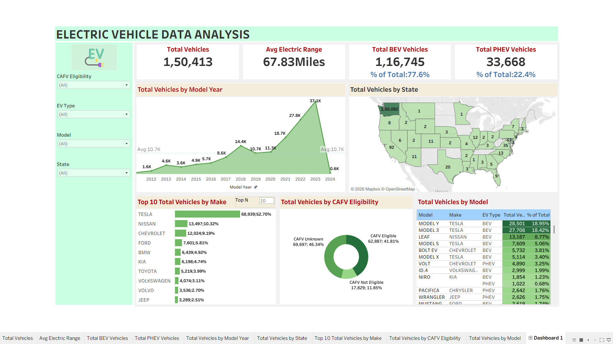

# ⚡ EV Analytics Dashboard

## 1. Project Title 

### ⚡ EV Insights: Electric Vehicle Data Analysis Dashboard

An interactive Tableau dashboard designed to explore electric vehicle registration data, uncover adoption trends, compare manufacturers and vehicle models, and analyze geographical distribution, electric range, and CAFV eligibility. The project transforms raw vehicle data into meaningful visual insights to support data-driven decision-making in the evolving electric mobility industry.

## 2. Description / Purpose

The EV Analytics Dashboard is a data visualization project developed to analyze electric vehicle registration patterns using Tableau and Excel. It provides a consolidated view of key performance indicators (KPIs), year-wise vehicle distribution, state-wise registrations, leading manufacturers, popular vehicle models, and CAFV eligibility.

The primary purpose of this dashboard is to simplify complex registration data and help users understand electric vehicle adoption patterns, identify market representation, and explore geographical differences through clear, interactive visualizations. It is designed for data analysts, automotive researchers, business strategists, and stakeholders interested in electric mobility.

## 3. Tech Stack

The project uses the following tools and technologies:

- 📊 **Tableau Desktop** – Main data visualization platform used to create worksheets, charts, KPI summaries, and the consolidated dashboard.
- 📗 **Microsoft Excel** – Spreadsheet tool for working with tabular data and supporting data inspection and preparation, where applicable.
- 🧮 **Calculated Fields and Aggregations** – Used to calculate total vehicles, average electric range, BEV/PHEV counts, and their percentages.
- 📈 **Data Visualization** – Line/area charts, geographical maps, bar charts, pie/donut charts, and treemaps used to analyze different dimensions of EV registrations.
- 📂 **Data Analysis** – Comparative analysis of model years, states, manufacturers, vehicle models, electric vehicle types, and CAFV eligibility.
- 📁 **File Formats** – Tableau Packaged Workbook (`.twbx`) for the dashboard project and Excel-compatible tabular data for data handling, where applicable.

## 4. Data Source

**Dataset:** Electric Vehicle Population Data

The project uses an electric vehicle registration dataset containing attributes such as model year, manufacturer, vehicle model, state, county, city, postal code, electric vehicle type, electric range, and CAFV eligibility.

These fields support analysis of vehicle distribution, manufacturer representation, model popularity, and the composition of Battery Electric Vehicles (BEVs) and Plug-in Hybrid Electric Vehicles (PHEVs).

**Dataset reference:** (https://github.com/abhi1234-roy/Electric-Vehicle-Data-Analysis/blob/main/Electric_Vehicle_Population_Data.zip)

## 5. Features / Highlights

### • Business Problem

Electric vehicle registration data contains valuable information about adoption patterns, vehicle categories, manufacturers, and geographical distribution. However, analyzing individual records or disconnected statistics makes it difficult to identify important trends and compare different segments efficiently.

Questions such as which manufacturers have the highest representation, how registrations vary across model years and states, which vehicle models are most common, and how BEVs compare with PHEVs require a structured analytical approach.

The project addresses this challenge by bringing key metrics and visualizations together in a single dashboard.

### • Goal of the Dashboard

The objective is to develop a centralized analytical dashboard that:

- Summarizes the electric vehicle population using key performance indicators.
- Examines vehicle distribution across model years and geographical locations.
- Compares leading manufacturers and vehicle models.
- Analyzes the composition of BEVs and PHEVs.
- Presents CAFV eligibility categories in an easy-to-understand format.
- Supports faster exploration of registration patterns through visual analysis.

### • Walkthrough of Key Visuals

**1. Key Performance Indicators (KPIs)**

The dashboard presents the following summary metrics:

- Total Vehicles
- Average Electric Range
- Total BEV Vehicles
- Percentage of BEVs
- Total PHEV Vehicles
- Percentage of PHEVs

These indicators provide a high-level overview of the dataset and help users understand the composition of the recorded electric vehicle population.

**2. Vehicles by Model Year (Line/Area Chart)**

Displays vehicle distribution by model year, focusing on 2010 onward. This visualization helps identify changes in vehicle representation over time and examine broader adoption patterns.

**3. Total Vehicles by State (Geographical Map)**

Shows the geographical distribution of registered electric vehicles across states. It helps users identify regions with comparatively higher or lower vehicle representation.

**4. Top 10 Manufacturers (Bar Chart)**

Ranks the leading vehicle manufacturers according to their representation in the dataset. This enables quick comparison of manufacturers and supports market research.

**5. Vehicles by CAFV Eligibility (Pie/Donut Chart)**

Illustrates the distribution of vehicles across the recorded Clean Alternative Fuel Vehicle (CAFV) eligibility categories, making the classification easier to interpret.

**6. Top 10 Vehicle Models (Treemap)**

Displays the leading vehicle models based on vehicle counts. The treemap allows users to compare the relative representation of different models within the dataset.

### • Business Impact & Insights

**Market Analysis:** Manufacturers and automotive researchers can use vehicle counts by make and model to understand which brands and models have stronger representation in the dataset.

**Geographical Analysis:** State-wise distribution helps identify regional differences and provides a starting point for investigating local EV adoption and potential infrastructure needs.

**Trend Analysis:** Model-year comparisons help analysts examine changes in vehicle representation over time and identify patterns that may require further investigation.

**Vehicle Segment Analysis:** BEV/PHEV metrics provide an overview of the two major electric vehicle categories represented in the dataset.

**Strategic Planning:** The dashboard can support preliminary research by organizing registration information into a consistent visual format. Further data, such as charging station availability, travel behaviour, and population, would be needed to make detailed infrastructure or investment decisions.

**Improved Decision-Making:** By combining KPIs and multiple visualizations in one dashboard, the project reduces the effort required to interpret raw data and makes important comparisons easier to communicate.

## 6. Screenshots 

- **Tableau Workbook:** [Tableau_link](https://public.tableau.com/app/profile/abhishek.kumar6400/viz/ElectricVehiclesDataAnalysis_17930359009680/Dashboard1?publish=yes)
